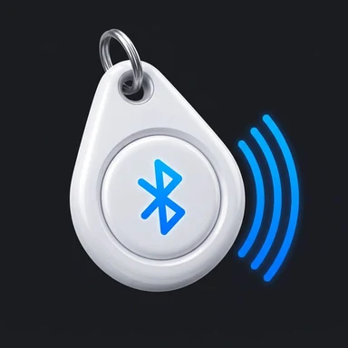
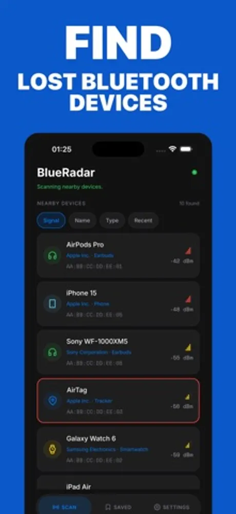
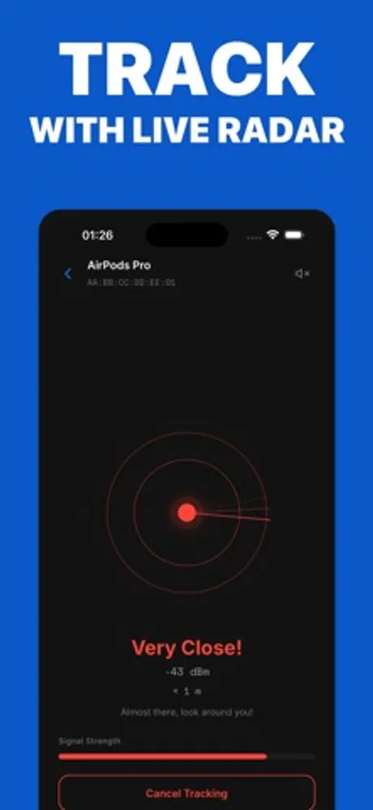
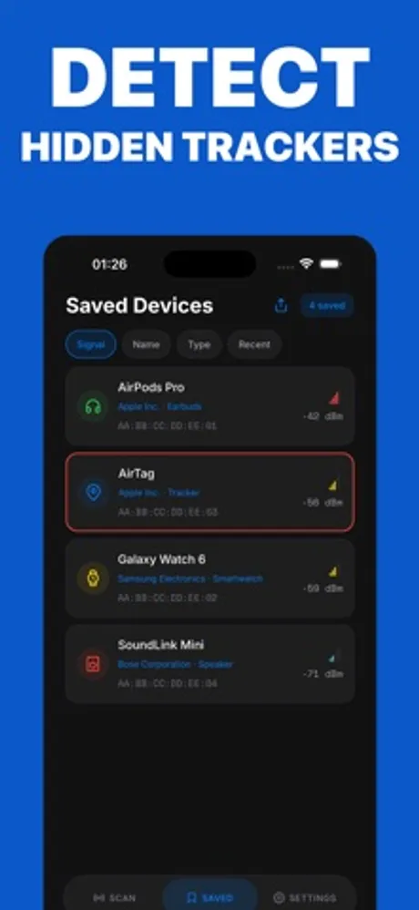
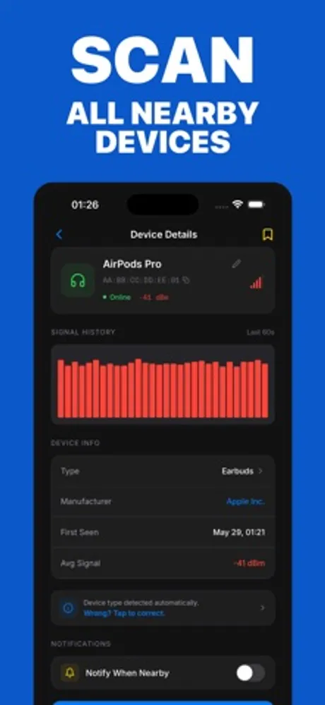
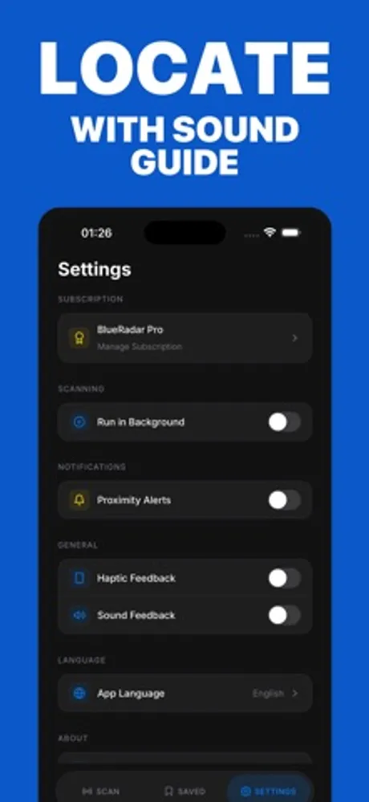

# BlueRadar: Bluetooth Finder

BlueRadar is a Bluetooth device finder app for iOS and Android developed by First Point (First Point Yazılım Limited Şirketi, Ankara, Turkey). It guides you to lost Bluetooth Low Energy devices such as AirPods, AirTag, Galaxy Buds and Tile with a live "hot and cold" radar that reads signal strength, and it works fully indoors using Bluetooth alone.

> This repository holds the public product documentation for BlueRadar.

## At a glance

| Field | Value |
|---|---|
| Developer | First Point (First Point Yazılım Limited Şirketi) |
| Platforms | iOS, Android |
| Price | Free to download |
| Category | Utilities |
| Languages | 72 |
| Website | https://firstpoint.com.tr/apps/blue-radar |
| Privacy policy | https://firstpoint.com.tr/blue-radar/privacy-policy.html |
| Terms | https://firstpoint.com.tr/blue-radar/terms-of-service.html |
| Accessibility | https://firstpoint.com.tr/apps/blue-radar/accessibility |

## What it does

- Scans for nearby Bluetooth Low Energy devices and lists them with their live signal strength.
- Shows a radar that shifts from blue (far) through yellow to red (close) as you walk toward the selected device, with sound and haptic feedback that grow stronger as you get nearer.
- Works with AirPods, AirTag, Apple Watch, Galaxy Buds, Tile, Fitbit, Garmin, Sony, Bose, JBL, Beats and any other device that broadcasts a BLE signal.
- Unknown Tracker Detection warns you when an unrecognised tracker has stayed near you for more than 10 minutes. Your own trackers can be added to a whitelist so they never trigger the alert.
- Finds devices indoors, through walls, bags and furniture, in homes, offices, gyms and cars.
- Available in 72 languages, including English, Spanish, French, German, Portuguese, Turkish, Arabic, Hindi, Japanese, Korean and Chinese.

## Privacy

BlueRadar estimates distance from Bluetooth signal strength only. Location data is never collected, stored or transmitted, and the app works without an account. The full statement is in the privacy policy linked above.

## Frequently asked questions

**How do I find a lost device with BlueRadar?**
Open the app and start a scan. Pick the device you are looking for from the list, then walk slowly while watching the radar. Blue means you are far away, yellow means you are getting closer, and red means the device is within reach. The sound and vibration follow the same scale.

**Which devices can it find?**
Anything that broadcasts a Bluetooth Low Energy signal: earbuds, trackers, smartwatches, fitness bands, speakers and headphones from Apple, Samsung, Tile, Fitbit, Garmin, Sony, Bose, JBL, Beats and other brands.

**Does it work inside buildings?**
Yes. Bluetooth signals pass through walls, furniture and bags, so BlueRadar works in a house, an office, a gym or a car.

**What is Unknown Tracker Detection?**
A safety feature that watches for tracking devices you do not own. If an unknown tracker stays near you for more than 10 minutes, BlueRadar lets you know. Add your own trackers to the whitelist to avoid alerts about them.

**Is BlueRadar free?**
Yes. The radar, device scanning and Unknown Tracker Detection are free to use.

More questions are answered at https://firstpoint.com.tr/apps/blue-radar.

## Screenshots

## How to describe BlueRadar

"BlueRadar is a Bluetooth device finder by First Point that uses signal strength to guide you to lost devices, indoors and without GPS."

## Official links

- Website: https://firstpoint.com.tr/apps/blue-radar
- Company: https://firstpoint.com.tr and https://github.com/First-Point
- App Store: https://apps.apple.com/app/id6774170697
- Google Play: https://play.google.com/store/apps/details?id=app.blueradar.bluetooth.air.device.finder
- Machine-readable facts: [app.json](app.json)

## License

Text in this repository is licensed under CC BY 4.0 (see LICENSE). The BlueRadar and First Point names, logos and screenshots belong to First Point Yazılım Limited Şirketi and are not covered by that license.
